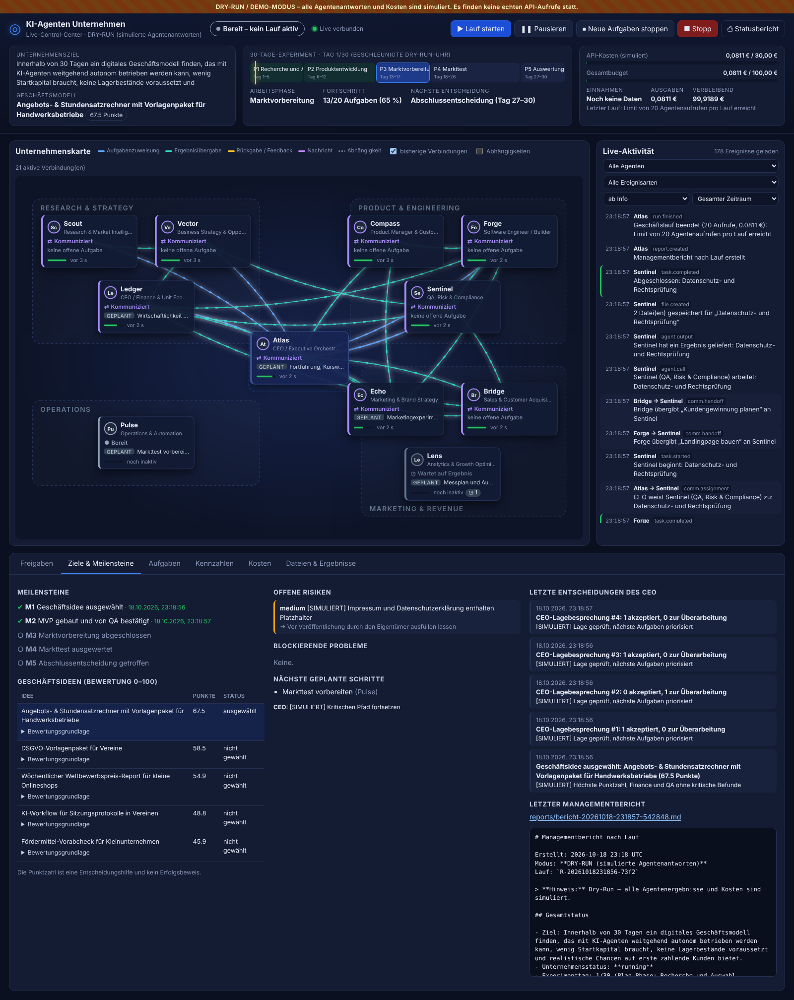

# KI-Agenten Unternehmen

Ein autonomes digitales Unternehmen aus **11 spezialisierten KI-Agenten**. Es sucht in einem 30-Tage-Experiment ein
tragfähiges digitales Geschäftsmodell, baut ein MVP, bereitet den Markttest vor, wertet echte Ergebnisse aus und
berichtet regelmäßig. Ein **Live-Control-Center** zeigt in Echtzeit, was jeder Agent tut, wer mit wem kommuniziert
und welche Entscheidungen auf den Eigentümer warten.



- **Konzept**: [CONCEPT.md](CONCEPT.md) · **Architektur**: [ARCHITECTURE.md](ARCHITECTURE.md) · **Agenten**: [AGENTS.md](AGENTS.md)
- **Budget**: [BUDGET.md](BUDGET.md) · **Sicherheit**: [SECURITY.md](SECURITY.md) · **30-Tage-Plan**: [docs/PLAN_30_TAGE.md](docs/PLAN_30_TAGE.md)
- **Testbericht**: [TEST_REPORT.md](TEST_REPORT.md) · **Beispiel-Lauf**: [examples/dry_run_example.md](examples/dry_run_example.md)

## Voraussetzungen

| Was | Version | Wofür |
|---|---|---|
| Python | 3.11 – 3.13 (getestet: 3.13) | Backend, Agenten, Tests |
| Node.js | ≥ 20 (getestet: 22) | nur zum **Neubauen** des Control-Centers und für Frontend-Tests; ein fertiger Build liegt in `frontend/dist` |
| OpenAI-API-Schlüssel | – | **nur Live-Modus** (verursacht Kosten) |

## Installation

```bash
git clone <repo> ki-agenten && cd ki-agenten
python3 -m venv .venv && source .venv/bin/activate
pip install -r requirements-dev.txt
pip install -e .
cp .env.example .env            # optional; im Dry-Run nicht nötig
```

## Schnellstart ohne Kosten (Dry-Run)

```bash
aicompany demo                  # kompletter 30-Tage-Zyklus mit simulierten Agentenantworten (~2 s)
aicompany --data-dir data/demo serve
# → öffnet: http://127.0.0.1:8765/#token=…   (Link steht im Terminal)
```

Im Control-Center kannst du dann Freigaben genehmigen oder ablehnen, Agenten pausieren, Kennzahlen erfassen und Berichte
lesen. Ein frisches Unternehmen im Dry-Run, das du Lauf für Lauf über die Oberfläche steuerst:

```bash
aicompany init                  # legt data/dry_run/ an
aicompany serve                 # dann im UI auf „▶ Lauf starten“ klicken
```

**Ohne Zugangsdaten testbar:** alles (Orchestrierung, Budgetlimits, Freigaben, Sicherheit, UI, Wiederanlauf). Der Dry-Run
nutzt ein deterministisches Simulations-Backend. Alle Inhalte sind als **[SIMULIERT]** gekennzeichnet und sind keine echte
Marktrecherche.

## Live-Betrieb

```bash
# 1. Schlüssel eintragen
echo "OPENAI_API_KEY=sk-..." >> .env
# 2. Preise in config/settings.toml mit der offiziellen Preisseite abgleichen, Limits prüfen
# 3. Selbsttest – Pflicht: Der Live-Modus startet nur, wenn die Tests für genau diesen Codestand bestanden sind
aicompany selftest
aicompany preflight             # zeigt, ob alles bereit ist
# 4. Starten
aicompany --mode live serve     # Control-Center; Läufe per Button
# oder per Kommandozeile / Scheduler:
aicompany --mode live run
aicompany --mode live scheduler --interval 360 --max-runs 8
```

Zusätzlich empfohlen: ein **Ausgabenlimit im OpenAI-Konto** und ein eigener API-Schlüssel nur für dieses Projekt.

### Wiederkehrende Ausführung per cron (Alternative zum Scheduler)

```cron
# alle 6 Stunden ein Geschäftslauf; der DB-Lock verhindert Überschneidungen
0 */6 * * *  cd /pfad/ki-agenten && .venv/bin/aicompany --mode live run >> data/live/cron.log 2>&1
```

## Externe Accounts und Kosten

| Dienst | Nötig? | Kosten | Wird vom System genutzt |
|---|---|---|---|
| OpenAI API | nur Live | nach Verbrauch, gedeckelt (Standard 30 €/Monat) | ja, automatisch |
| OpenAI-Websuche | nur Live | ~0,01 $/Suche | ja, automatisch (max. 8/Lauf) |
| Domain / Hosting | ab Markttest | ~1–7 €/Monat | **nein**: Release-Paket wird lokal exportiert, Upload macht der Mensch |
| Zahlungsanbieter | ab Markttest | Gebühr je Verkauf | **nein**: nie automatisch |
| E-Mail-Versand | optional | – | **nein**: Nachrichten landen im lokalen Postausgang |
| Werbung | optional | nach Freigabe | **nein**: nur Antrag, Ausführung manuell |

## Befehle

| Befehl | Zweck |
|---|---|
| `aicompany init` | Datenverzeichnis, DB, Owner-Token anlegen |
| `aicompany run` | einen Geschäftslauf ausführen (max. 20 Aufrufe / 2 €) |
| `aicompany demo [--max-runs N]` | vollständiger Dry-Run in `data/demo` |
| `aicompany serve [--port]` | Control-Center + API (nur 127.0.0.1) |
| `aicompany scheduler --interval MIN --max-runs N` | begrenzte wiederkehrende Läufe |
| `aicompany status` / `report` | Kurzstatus / Managementbericht |
| `aicompany selftest` / `preflight` | Tests ausführen / Live-Bereitschaft prüfen |

Globale Optionen: `--mode dry_run|live`, `--data-dir PFAD`. Daten liegen getrennt je Modus unter `data/<modus>/`
(Datenbank, Workspace mit allen Agentenergebnissen, Releases, Postausgang).

## Tests

```bash
python -m pytest                      # Backend: 110 Tests, keine API-Kosten
cd frontend && npm ci && npm test     # Frontend-Logik: 14 Tests (Vitest)
npm run build                         # Typecheck + Produktionsbuild nach frontend/dist
PW_CHROMIUM_PATH=/pfad/zu/chrome npx playwright test   # End-to-End im Browser gegen echtes Backend (Dry-Run)
```

(`PW_CHROMIUM_PATH` ist nur nötig, wenn kein Playwright-Browser installiert ist; sonst `npx playwright install chromium`.)

## Projektstruktur

```
config/settings.toml      Limits, Modelle, Preise, Uhr, Server
config/security.toml      Berechtigungen, Aktionsklassen, Grenzen (für Agenten unerreichbar)
src/aicompany/            Backend (siehe ARCHITECTURE.md)
frontend/                 Control-Center (React + TypeScript + Vite), dist/ = fertiger Build
tests/                    pytest-Suite
examples/                 Beispiel eines vollständigen Dry-Run-Laufs
docs/                     30-Tage-Plan, Screenshot
```

## Bekannte Grenzen

Siehe [TEST_REPORT.md](TEST_REPORT.md#was-fehlt--bekannte-grenzen). Kurz: Der Live-Modus wurde mangels API-Schlüssel in
dieser Umgebung nur mit einer SDK-Attrappe getestet, nicht gegen die echte API. Veröffentlichung, Zahlungen und
E-Mail-Versand sind bewusst manuell. Kennzahlen kommen aus manueller Eingabe; eine Analytics-Anbindung fehlt noch.
